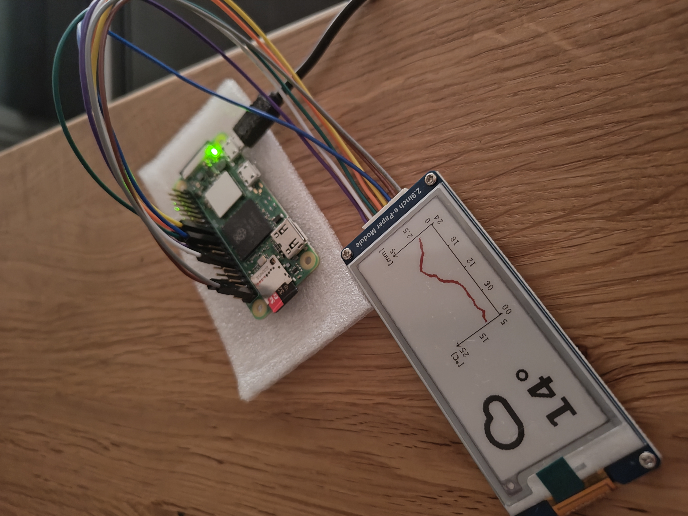

# PiWeather
Use a Raspberry Pi Zero 2 W to make a weather display. Implemented open-meteo API call in Python and rendering using PIL. The script is automatically executed on startup and every 15 minutes using crontab.

